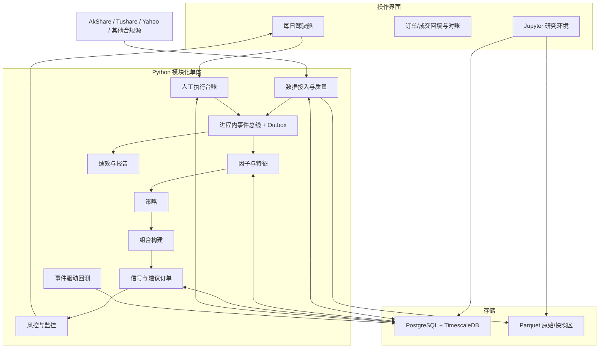
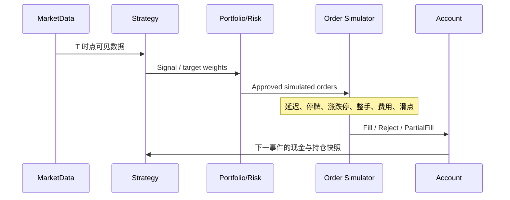

# 顶层架构

## 1. 架构原则

第一阶段采用模块化单体：一个 Python 代码库、一个 API 服务、独立 worker 进程和一个主数据库。模块通过明确的数据契约与领域事件解耦，但不提前拆微服务。

理由是当前为单账户、日频、人工执行，吞吐量远低于复杂分布式系统的必要门槛。真正困难的是 point-in-time 数据、交易规则、可复现性和对账，而不是消息吞吐。

## 2. 逻辑视图

## 3. 技术选型结论

| 能力 | 第一阶段选择 | 暂不选择及原因 |
|---|---|---|
| 语言 | Python 3.12，类型检查、pytest | 无需多语言 |
| API | FastAPI + Pydantic | 适合显式契约和后续前端 |
| 前端 | Streamlit MVP；交互稳定后可换 React | 当前没有复杂多用户前端需求 |
| 关系与行情 | PostgreSQL + TimescaleDB | 日/分钟级单账户没有必要再维护 ClickHouse 或 InfluxDB |
| 原始与研究资产 | 按数据集/批次分区的 Parquet | 不把散落 Parquet 当生产事实库 |
| 调度 | Prefect 或简单受控 worker，二选一后实施 | Airflow 对当前规模偏重 |
| 缓存 | 先用进程内短缓存和数据库索引 | Redis 等出现跨进程缓存/锁/限流需求再加 |
| 消息 | 进程内事件 + PostgreSQL transactional outbox | Kafka 面向持续高吞吐日志流；RabbitMQ 也不是日频 MVP 的刚需 |
| 后续异步 | RabbitMQ | 当任务拆进程且需要路由、确认、重试时启用；只有接入 Tick 流才评估 Kafka/Redpanda |
| 研究 | JupyterLab + 版本化 Python 包 | Notebook 不直接生产运行 |

TimescaleDB 是 PostgreSQL 扩展，保留 SQL、事务和外键能力，同时可按时间分区与压缩。若将来分钟数据量经基准测试证明 PostgreSQL 无法满足，再把行情冷数据迁移到 ClickHouse；不采用 InfluxDB，因为跨证券主数据、成分、公司行动的关系查询仍会回到 PostgreSQL。

## 4. 模块边界

| 模块 | 负责 | 不负责 |
|---|---|---|
| instruments | 证券身份、交易所、板块、币种、生命周期、交易规则 | 行情值 |
| market_data | 原始行情、公司行动、复权因子、交易日历 | 选股逻辑 |
| fundamentals | 财报事实、公告/可用时间、修订 | 用当前最新版覆盖历史 |
| universe | 港股通/指数/行业等 point-in-time 成分 | 静态全历史股票池 |
| features | 因子定义、计算、版本和物化 | 决定仓位 |
| strategies | 从时点快照生成预期/评分/目标候选 | 写实际账户 |
| portfolio | 约束下生成目标权重和现金权重 | 假定必然成交 |
| signals | 冻结并发布可审计建议 | 券商下单 |
| execution_ledger | 订单、成交、费用、人工确认和对账 | 自动连接券商 |
| backtest | 用相同策略和交易规则模拟订单事件 | 用向量化结果替代最终验证 |
| risk | 事前/事后规则、告警和限额 | 修改原始数据 |
| reporting | 归因、绩效、运营报告 | 成为事实来源 |

## 5. 关键数据流与一致性

1. 采集器把源响应先落原始区，生成不可变 `dataset_batch_id`。
2. 标准化写入暂存表，校验通过后在单事务内合并事实表。
3. 同一事务写入 outbox 事件；worker 在提交后处理因子、信号等下游任务。
4. 信号发布时冻结输入快照和版本，不随后续数据修订而静默变化。
5. 人工成交回填写入订单/成交事实，派生实际持仓；任何手工修订保留前后值和原因。

## 6. 回测事件模型

研究用向量化引擎可以作为快速筛选器，但候选策略的正式结果只能由该事件模型给出。订单默认在信号之后的下一可交易 bar 才有资格成交。

## 7. 前端最小页面

- 今日状态：数据批次、质量门禁、策略运行、风控、待办。
- 信号审批：目标/当前权重、建议交易、原因、风险提示、接受/部分接受/拒绝。
- 执行回填：订单、成交、费用、CSV 导入、异常校验。
- 持仓与风险：实际持仓、现金、币种、行业/市场/标的暴露、回撤。
- 对账：建议—订单—成交—持仓差异，未解决项阻断状态。
- 研究与报告：回测版本、样本外结果、论文交易、策略状态。

## 8. 部署边界

第一阶段本机或单台受控服务器部署：API、worker、PostgreSQL/TimescaleDB 和前端分别为容器，但共享同一版本发布。数据库不暴露公网，数据源密钥通过环境变量注入。系统仍需每日备份、健康检查和失败告警。
