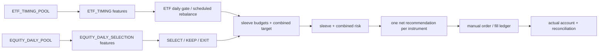

# 模块规格完成审计

审计对象是[对齐目标](../00-aligned-goal.md)，不是“当前已有多少文件”。本页把每项完成声明映射到可直接检查的权威证据。

## 14 个模块交付矩阵

| 模块 | 唯一事实/责任 | 输入输出与时间语义 | 幂等/唯一性 | 机器可判验收 |
|---|---|---|---|---|
| instruments | 身份、别名、生命周期、交易规格 | source record → `instrument_id`，按 `as_of` | 来源记录 + revision | 别名区间/重跑黄金案例 |
| market_data | RAW Bar、日历、行动、复权因子 | batch → snapshot，按 bar/可用时间 | source + checksum | 异常 OHLC、复权、时区 |
| fundamentals | 带修订的财务事实 | filing → facts，`available_at <= decision_at` | filing + revision | 公告前不可见、修订不覆盖 |
| universe | 时点成员与分类 | source batch → ETF/个股 snapshot | universe + source batch | 历史成分、双池隔离 |
| features | 因子版本和值 | snapshots → feature set，滚动窗口截止 as_of | 全输入哈希 | 未来数据不改历史、双用途隔离 |
| strategies | ETF 择时、个股日频选择 | 冻结输入 → 独立 run/candidates | kind + snapshot + 参数哈希 | 两策略黄金案例、交换输入失败 |
| portfolio | sleeve 合并目标 | 两个 run + account → 净目标 | run 集合 + policy + account | 缺 run 拒绝、冲突净额 |
| signals | 决策组件、审批、净建议 | target → T+1 建议/审批状态 | 输入哈希 + 乐观锁 | 同证券至多一条净建议 |
| execution_ledger | 订单、成交、费用、实际账 | fill/cash event → as-of account snapshot | broker fill/import hash | 部分成交、重复导入、对账阻断 |
| backtest | 事件、模拟成交与账户 | strategy bundle → 固定结果 | 全输入 + seed 哈希 | 下一 bar、T+1、双策略事件顺序 |
| risk | 规则、检查、告警 | sleeve/combined snapshot → decision | 输入 + policy | fail closed、分项 block 阻断整体 |
| reporting | 报告快照与归因 | frozen inputs → versioned artifact | 输入 + 模板哈希 | sleeve 与组合对账 |
| api_ui | 人工操作与展示 | versioned commands/queries → 状态 | Idempotency-Key + version | 双击、冲突、双策略驾驶舱 |
| platform_operations | 批次、任务、Outbox、readiness | business date/events → task state | task input/event ID | 崩溃恢复、双 run readiness |

每份编号文档都由 `tools/validate_docs.py` 精确检查以下章节：目标与边界、所有数据、接口契约、主流程、业务规则、失败/幂等、可观测/安全、测试/验收、不做事项；同时要求 Command、Query、Event、返回语义、时间语义和幂等语义存在。

## 双策略闭环证据



- [证券池](04-universe.md)和[特征](05-features.md)证明两条策略不会共享含义不明的快照。
- [策略](06-strategies.md)证明 ETF 日频门控/周度调仓与个股每日 `SELECT/KEEP/EXIT` 分别运行。
- [组合](07-portfolio.md)和[信号](08-signals.md)证明两策略先合并目标再下净建议，不叠加订单。
- [回测](10-backtest.md)、[风控](11-risk.md)、[报告](12-reporting.md)证明正式评估同时保留 sleeve 与组合证据。
- [平台运行](14-platform-operations.md)证明任一 required run 失败时整体不能假成功。

## 全局不变量证据

| 不变量 | 权威证据 |
|---|---|
| 证券引用使用 canonical `instrument_id` | 模块索引依赖规则；各事实模块的数据/接口字段；验证器关键文本检查 |
| 财务/成分不看未来 | fundamentals、universe、features、strategies、backtest 的 decision_at 契约 |
| 实际持仓只由成交/资金事件派生 | execution_ledger 所有数据、流程与反向对账测试 |
| 回测最早下一可交易 bar 成交 | backtest BrokerSimulator 契约与黄金案例 |
| 建议不等于成交 | signals 边界；execution_ledger 事实所有权；reporting 实际绩效口径 |

## 验收命令

在 `QuantTradingSystem` 目录运行：

```powershell
python tools\validate_docs.py
```

完成判据是退出码 0，并同时输出 `14 module docs: PASS`、`baseline hashes: PASS`、`links: PASS`。反向验证必须证明删除必需标题或删除双策略关键不变量都会返回非 0，恢复后再全绿。

## 实现验收证据（2026-07-28）

- 14 个模块代码及迁移均已交付。本地最终验证为 `1486 passed in 8.32s`、0 skipped；mypy 检查 125 个源码文件无错误，compileall 与文档校验退出码均为 0。
- 平台模块已覆盖任务租约/fencing、保留历史 attempt 的重试、事务 Outbox、消费幂等、双策略 readiness、备份恢复控制、健康检查和单机部署资产。
- 反向变异曾移除个股日频 required run，黄金测试正确失败；恢复后全量通过。
- 真实 PostgreSQL、容器启动及隔离恢复演练仍为外部阻塞，不以 SQLite 或静态配置检查替代。
