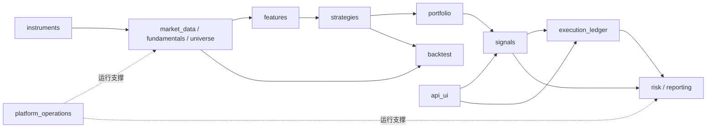

# 模块开发文档索引

本目录把[需求基线](../01-requirements.md)、[顶层架构](../02-architecture.md)和[数据字典](../05-data-dictionary.md)细化为可编码、可测试的模块契约。上位文档发生冲突时，以需求边界和时点正确性优先；冲突必须通过架构决策记录解决，不能在模块内部静默绕过。

完成情况与逐条证据见[模块规格完成审计](COMPLETION-AUDIT.md)。

## 模块地图

| # | 模块 | 唯一事实所有者 | 主要下游 |
|---:|---|---|---|
| 01 | [证券主数据](01-instruments.md) | 证券身份、代码别名、生命周期、交易规格 | 所有业务模块 |
| 02 | [市场数据](02-market-data.md) | 交易日历、未复权 Bar、公司行动、复权因子 | 特征、回测、信号、风控 |
| 03 | [基本面](03-fundamentals.md) | 带公告/可用时间和修订的财务事实 | 特征、策略 |
| 04 | [证券池](04-universe.md) | 港股通/行业/指数等时点成员关系 | 策略、组合、风控 |
| 05 | [特征与因子](05-features.md) | 因子定义、版本和时点值 | 策略、报告 |
| 06 | [策略](06-strategies.md) | ETF 择时与个股日频选股的定义、独立运行、评分与候选目标 | 组合构建 |
| 07 | [组合构建](07-portfolio.md) | 双策略 sleeve 合并、约束求解、目标权重与现金权重 | 信号、风控 |
| 08 | [信号与建议](08-signals.md) | 已冻结信号、建议订单和审批 | 执行台账 |
| 09 | [执行台账](09-execution-ledger.md) | 订单、成交、费用、资金事件和实际账户派生账 | 风控、报告 |
| 10 | [事件驱动回测](10-backtest.md) | 模拟订单/成交、回测账户和结果 | 策略评审、报告 |
| 11 | [风控](11-risk.md) | 风控规则版本、检查结果、告警 | 信号、执行、驾驶舱 |
| 12 | [报告](12-reporting.md) | 报告快照与可追溯展示，不持有源事实 | API/前端 |
| 13 | [API 与前端](13-api-ui.md) | 用户操作、会话级命令和展示模型 | 人工执行闭环 |
| 14 | [平台运行](14-platform-operations.md) | 批次、任务、Outbox、审计、配置与运行状态 | 全部模块 |

## 依赖规则

- 下游通过公开查询或事件读取上游事实，不能直接写上游表。
- 跨模块引用使用稳定 ID；不得用证券代码、名称或 DataFrame 行号作为外键。
- 事件是已发生事实，使用过去式命名；命令是请求，失败必须有明确结果。
- 时间相关查询必须携带 `as_of`/`decision_at`，不能默认“最新”。
- 首批 `ETF_TIMING` 与 `EQUITY_DAILY_SELECTION` 分别冻结输入和运行；组合层按版本化 sleeve 预算合并，信号层只对合并后的净差额生成订单建议。

## 跨模块事件最小集合

`DatasetBatchPublished`、`InstrumentStatusChanged`、`CorporateActionPublished`、`FeatureSetCalculated`、`StrategyRunCompleted`、`TargetPortfolioBuilt`、`SignalPublished`、`RecommendationApproved`、`OrderRecorded`、`FillRecorded`、`AccountReconciled`、`RiskBreachDetected`、`ReportSnapshotBuilt`。

所有事件至少包含 `event_id`、`event_type`、`occurred_at`、`recorded_at`、`correlation_id`、`causation_id`、`schema_version`；平台 Outbox 以 `event_id` 保证消费幂等。

## 通用完成定义

- 契约含类型、时间语义、唯一键/幂等键和错误语义。
- 单元测试覆盖规则；契约测试覆盖模块边界；集成测试使用真实 PostgreSQL schema；关键时序有黄金案例。
- 日志不含 token 或账户敏感明细；所有人工修改可追溯。
- 任一模块失败都能通过任务状态、结构化日志或告警被发现，不允许静默降级为成功。
